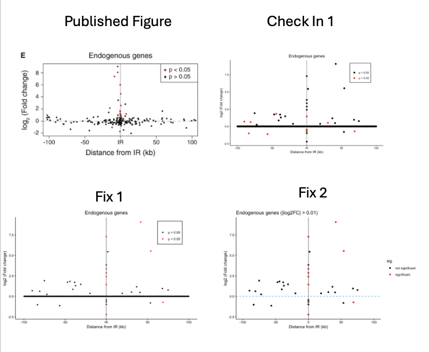

# Project Check-in — November 19, 2026

## 1. Addressing Previous Feedback

We revised Figure 6B using one million random genomic coordinates as the background instead of genome-wide enhancer density. We also applied quantile-based binning to Figure 6C, as suggested. Our scripts remain modular, and we plan to add a master script to automate the pipeline.

For Figure 6E, (1) No, we did not confine analysis to only the nearest gene to the IR. We made a window surrounding the IR and extracted all genes within the window. (2) Yes, I pooled the padj values across the cell lines for correcting for multiple hypothesis testing. This was an important step to consider in this follow-up because we learned that changing the order of filtering genes within the IR window and applying multiple hypothesis testing made a major impact on the plot.

## 2. New Progress

**Figure 6B:** We completed the revised enhancer enrichment analysis using both genome-wide and intergenic-only random backgrounds. Both showed enrichment near gene boundaries, resolving the issue of all bins being above background.

**Figure 6C:** We completed the enhancer proximity analysis using 3,058 IRs and 10 quantile bins. We also added a 0–50 kb analysis to examine short-range effects.

**Figure 6D:** We completed the gene proximity analysis using 5,636 IRs after excluding those with nearby enhancers. Reporter expression increased near gene boundaries, consistent with the original paper. We also added a 0–50 kb analysis.

**Figure 6E:** Last check in, the largest concern for this plot was that the plot did not look like the published figure (many zeros at the X axis, and notably significant dots not enriched at IR). While My plot still does not match the published figure, I think the plot has improved. The most supstantial improvement (Fix 1) was doing multiple hypothesis testing only on the genes shown in the plot, rather than the entire transcriptome. This led to the expected enrichment of significant genes in close proximity to the IRs. Now, the main concerns are (1) the many zeros at the X axis, (2) much fewer genes (3) less nonsignificant gene enrichment around the IR. The reason I would expect (3) is that the piggybac transposon has a known bias to gene rich regions (PMID: 23358416). These concerns are still being adressed, but these are the changes were tested and considered:

+--------------------------------------------------------------------------------------------------------------------------------------------+------------------------------------------------------------------------------------------------------------------+-------------------------------------------------------------------------------------------------------------------------------------------------------------------------------------------------------------+
| Change to plot                                                                                                                             | Reason                                                                                                           | Effect on Plot                                                                                                                                                                                              |
+============================================================================================================================================+==================================================================================================================+=============================================================================================================================================================================================================+
| Apply holms method multiple hypothesis testing after filtering the gene list present in the window surrounding the IRs (instead of before) | Reduce the multiple hypothesis testing burden by only applying it to the genes being visualized in the IR window | This                                                                                                                                                                                                        |
|                                                                                                                                            |                                                                                                                  |                                                                                                                                                                                                             |
|                                                                                                                                            |                                                                                                                  | See 'Fix1'                                                                                                                                                                                                  |
+--------------------------------------------------------------------------------------------------------------------------------------------+------------------------------------------------------------------------------------------------------------------+-------------------------------------------------------------------------------------------------------------------------------------------------------------------------------------------------------------+
| Subset genes to only 'expressed' genes, using `/Users/cmdb/trip-genomic-context/enhancer-IR/data/processed/gene-expression-status.tsv`     | reduce the zero accumulation that cover the X-axis                                                               | No effect, all genes in the datatable used to plotdata were in the 'expressed' category                                                                                                                     |
+--------------------------------------------------------------------------------------------------------------------------------------------+------------------------------------------------------------------------------------------------------------------+-------------------------------------------------------------------------------------------------------------------------------------------------------------------------------------------------------------+
| Remove shrinkage step from DESeq2                                                                                                          | Shrinkage was not mentioned in the methods, but this assumption in my reanalysis may changed the log2FC          | To my surprise, I did not see an effect, so I am still checking my scripts to make sure this isn't a mistake I made re-running the analysis                                                                 |
+--------------------------------------------------------------------------------------------------------------------------------------------+------------------------------------------------------------------------------------------------------------------+-------------------------------------------------------------------------------------------------------------------------------------------------------------------------------------------------------------+
| Filter out genes with Log2FC \<0.1 (Not for the final plot, but to visualize)                                                              | See how plot looks without the many genes with Log2FC close to zero.                                             | See 'Fix2'. I don't think this should be used for the final plot, but I think its important to see that many of my plotted genes are different from the published figure because they have smaller log2FC.  |
+--------------------------------------------------------------------------------------------------------------------------------------------+------------------------------------------------------------------------------------------------------------------+-------------------------------------------------------------------------------------------------------------------------------------------------------------------------------------------------------------+

{width="454"}

Stretch Goal: Visualization with MicroC:

## 3. Project Organization

We maintain separate `enhancer-IR/` and `rnaseq/` directories, with modular scripts, detailed READMEs, and summary tables for reproducibility. Large intermediate files are excluded from GitHub.

## 4. Challenges and Questions

- **Background selection:** Which background is more appropriate for Figure 6B: genome-wide or intergenic-only random coordinates?
- **Sample sizes:** Figures 6C and 6D include more IRs than the original study because of differences in enhancer annotations and filtering. How should we best address these differences?
- **Pipeline:** We plan to integrate our scripts into a master pipeline.
- **Figure 6E:** The troubleshooting of this step is detailed in the 'New Progress' Section, but the main challenges from this plot is finding where many of the genes were lost or plotted so differently in the re-made figure. One thing I think I should try next is re-calculating the padj in DESeq using `p.adjust(res_subset$pvalue, method = "BH")` only on the filtered genes near IRs to see if any more genes have significance. However, I don't think this will change the differences in Log2FC, so I welcome any ideas to try.
