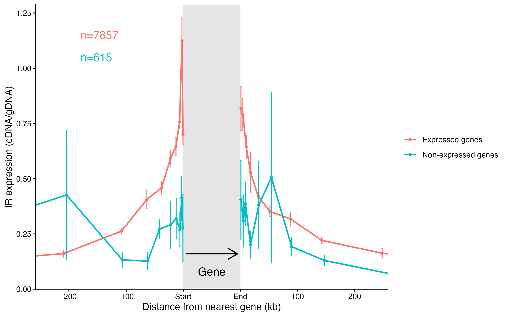
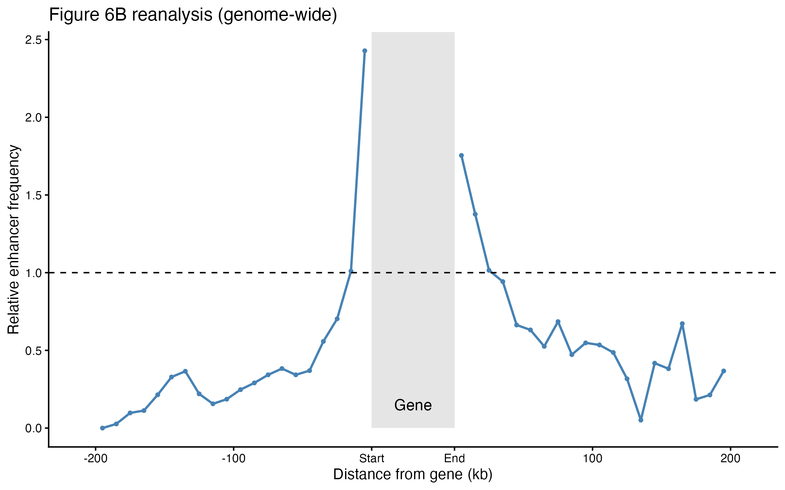
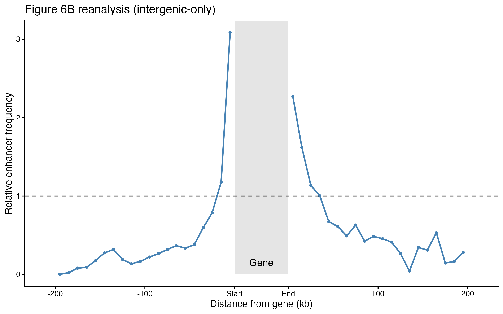
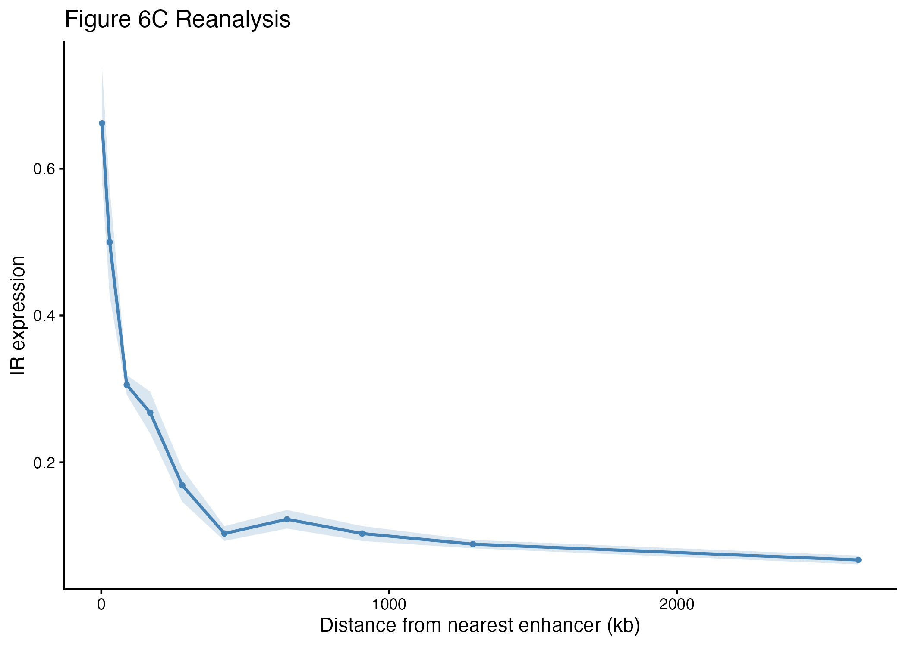
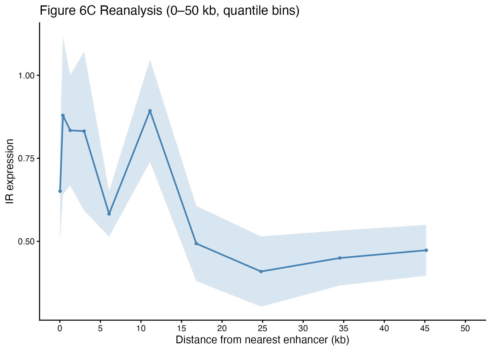
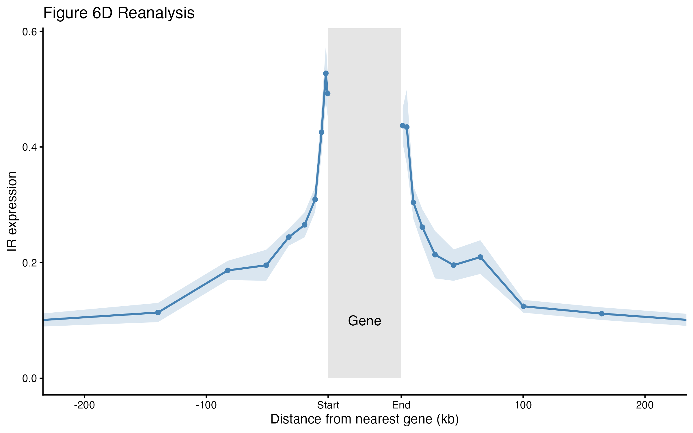
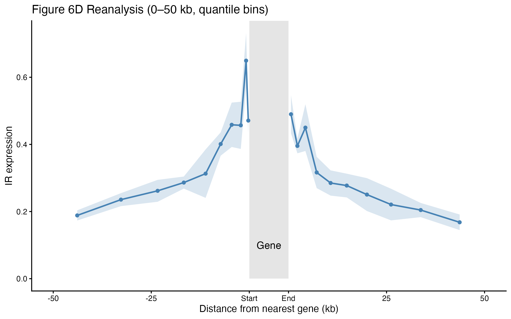

# Goal 1: Reproduce Figure 6 from Akhtar et al. (2013)

## Step 1: Convert TRIP integration coordinates from mm9 to mm10

- Convert the original TRIP integration file (`mmc2.txt`) into BED format.
- Use UCSC LiftOver to convert TRIP integration coordinates from mm9 to mm10.
- Use R to merge the original TRIP count columns with the lifted mm10 coordinates by matching `pool_barcode`.
- A total of 17,857 mPGK reporter integration sites (IRs) were included in the processed dataset.

Script: `scripts/txt-to-bed.sh`, `scripts/merge_mm10.Rmd`

## Step 2: Reanalyze Figure 6A

### 2.1 Classify genes as expressed or non-expressed

- We used RNA-seq counts from 11 monoclonal mESC lines (`mmc5.txt`).
- A gene was classified as expressed if at least one sample had a count > 0; otherwise, it was classified as non-expressed.
- A total of 18,463 genes were classified as expressed and 3,906 as non-expressed.
- Because the RNA-seq count table uses gene IDs from the older mm9-era annotation, we lifted that gene annotation from mm9 to mm10 while retaining the original Ensembl gene IDs.
- 37,494 gene records were successfully converted; 187 failed conversion.

Script: `scripts/6A_gtf-to-genebed.py`, `scripts/6A_make_gene_expression_status.py`

### 2.2 Identify intergenic TRIP IRs

- We identified intergenic IRs using the full gene annotation.
- A total of 8,472 intergenic IRs were identified.

Scripts: `6A_find_intergenic_IRs.sh`

### 2.3 Filter genes based on RNA-seq data

- We retained only genes with Ensembl IDs present in the RNA-seq count table.
- 22,241 of the 37,494 annotated genes were retained.

Scripts: `6A_filter_genes.py`

### 2.4 Find the nearest gene for each intergenic IR

- We recalculated the nearest gene using the filtered gene annotation.
- Therefore, the nearest gene refers to the nearest gene with available RNA-seq counts, which may not be the nearest gene in the full annotation.
- Nearest genes were assigned based on genomic distance using `bedtools closest`.
- Ties were retained, resulting in 8,475 IR-gene assignments for 8,472 intergenic IRs.

Scripts: `6A_find_nearest_gene.sh`

### 2.5 Assign gene expression status

- All 8,475 IR-gene assignments were successfully matched to RNA-seq expression status.
- No assignments were missing expression status.
- Among the 8,472 unique IRs, 7,857 were associated with expressed genes and 615 with non-expressed genes.

Scripts: `6A_add_gene_expression_status.py`

### 2.6 Assign gene side

- We classified IRs as being on the Start or End side of the nearest gene based on gene strand and genomic position.
- 4,778 IR-gene assignments were on the Start side, and 3,697 were on the End side.

Scripts: `6A_assign_gene_side.py`

### 2.7 Divide IRs into distance bins

- We divided IR-gene assignments into 10 equal-count distance bins separately for the Start and End sides.
- Expressed and non-expressed genes shared the same distance-bin boundaries on each side.
- All 8,475 IR-gene assignments were included in the analysis.

Scripts: `6A_make_distance_bins.py`

### 2.8 Calculate IR expression and reproduce Figure 6A

- We calculated reporter expression as the ratio of summed cDNA counts to summed gDNA counts across two technical replicates.
- For each TRIP pool, gene expression status, gene side, and distance bin, we calculated the median IR expression.
- We then calculated the mean and standard error of the mean (SEM) across the six mPGK pools.
- Of the 40 groups, 38 contained data from all six pools, while two contained data from five pools.
- We plotted IR expression as a function of distance from the nearest gene, separating the Start and End sides.

Scripts: `6A.Rmd`

### 2.9 Limitations

- The original endogenous gene expression dataset used for Figure 6A could not be identified.
- We therefore used the RNA-seq count matrix from the 11 monoclonal mESC lines, which was provided for the Figure 6E analysis.
- Gene expression status was determined using raw RNA-seq counts rather than the original FPKM-based classification.
- Nearest genes were selected only from genes with available RNA-seq counts. This may change nearest-gene assignments and distances compared with the original analysis.
- The reporter expression normalization used in this reanalysis is simplified and may differ from the original TRIP normalization method.
- Our reanalysis included 7,857 expressed-associated IRs and 615 non-expressed-associated IRs, compared with 5,435 and 2,746, respectively, in the published Figure 6A.
- Therefore, our current analysis reproduces the general relationship between gene proximity and reporter expression but does not fully reproduce the original Figure 6A.

### 2.10 Output files

- `data/processed/trip-distance-bins-filtered-mm10.tsv`: Processed IR-gene assignments with expression status, gene side, and distance bins.
- `results/figure6A_summary.tsv`: Mean IR expression, SEM, and distance information for each group.
- `results/figure6A_280kb.png`: Figure 6A reanalysis plot.

## Step 3: Reanalyze Figure 6B

**Goal:** Examine the distribution of active enhancer-like elements around endogenous genes and determine whether enhancers are enriched near gene boundaries.

Figure 6B in the original study shows the relative frequency of active intergenic enhancers around endogenous genes. We used ENCODE candidate cis-regulatory elements (cCREs) as an alternative enhancer annotation dataset and calculated enhancer enrichment relative to randomly sampled genomic positions.

### 3.1 Filter enhancer-like elements

We used the ENCODE cCRE dataset for mouse embryonic stem cells (mm10, ENCSR433TOM; BED file: ENCFF110IIC).

We selected two enhancer-like categories:
- **dELS:** distal enhancer-like signatures
- **pELS:** proximal enhancer-like signatures

| Category | Number |
|---|---:|
| Total cCREs | 499,693 |
| Enhancer-like elements (dELS + pELS) | 17,235 |
| Other elements removed | 482,458 |

Script: `scripts/6B_filter_enhancers.py`

### 3.2 Identify intergenic enhancers

We excluded enhancer-like elements overlapping annotated gene bodies using `bedtools intersect -v`.

- Input: 17,235 enhancer-like elements
- Output: **7,871 intergenic enhancer-like elements**
- Gene annotation: mm9 gene annotations lifted over to mm10

Script: `scripts/6B_find_intergenic_enhancers.sh`

### 3.3 Calculate distances from enhancers to the nearest gene boundary

We extracted the midpoint of each intergenic enhancer and the Start and End boundaries of each annotated gene.

| Statistic | Number |
|---|---:|
| Genes processed | 37,494 |
| Gene boundaries (Start + End) | 74,988 |
| Enhancer midpoints | 7,871 |

We used `bedtools closest -d -t first` to identify the nearest gene boundary for each enhancer midpoint and calculate the distance in base pairs.

All 7,871 enhancers were assigned to a nearest gene boundary.

Scripts:
- `scripts/6B_prepare_distances.py`
- `scripts/6B_find_nearest_boundary.sh`

### 3.4 Generate a random genomic background

Following the approach described in the original study, we generated **1,000,000 random genomic positions** using `bedtools random` with the mm10 chromosome sizes file and a fixed random seed (42).

We then used `bedtools closest` to calculate the distance from each random position to its nearest gene Start or End boundary.

Of the 1,000,000 random positions, 968 were located on additional scaffolds without matching gene boundary annotations and were excluded from the distance analysis.

We also generated an intergenic-only background by excluding random positions overlapping annotated gene bodies.

| Background dataset | Valid positions |
|---|---:|
| Genome-wide random positions | 999,032 |
| Intergenic-only random positions | 616,203 |
| Positions excluded due to missing gene boundaries | 968 |

The genome-wide random background was used for the primary analysis, while the intergenic-only background was used for a sensitivity analysis.

Script: `scripts/6B_random_background.sh`

### 3.5 Calculate relative enhancer frequency

We divided distances from the nearest gene boundary into **10 kb bins**, covering 0–200 kb, and analyzed Start and End boundaries separately.

For each bin, we calculated:

- **Observed frequency:** Number of enhancers in the bin divided by the total number of enhancers assigned to that boundary type.
- **Expected frequency:** Number of random positions in the bin divided by the total number of valid random positions assigned to that boundary type.
- **Relative enhancer frequency:** Observed frequency divided by expected frequency.

A relative frequency of 1 represents the expected frequency under the selected random background model.

We calculated relative frequencies using both genome-wide and intergenic-only random backgrounds.

**Results for the 0–10 kb distance bin:**

| Background | Start | End |
|---|---:|---:|
| Genome-wide | 2.43 | 1.75 |
| Intergenic-only | 3.09 | 2.27 |

Under both background models, enhancer-like elements were enriched within 10 kb of gene boundaries. The enrichment was stronger near gene Starts than gene Ends.

Using the genome-wide background, relative enhancer frequency on the Start side decreased from 2.43 at 0–10 kb to approximately 1.01 at 10–20 kb and 0.70 at 20–30 kb.

Scripts:
- `scripts/6B_calculate_relative_frequency.py`

Output:
- `data/processed/6B_relative-enhancer-frequency-mm10.tsv`

### 3.6 Plot Figure 6B

We plotted relative enhancer frequency against distance from the nearest gene Start or End boundary, using two background models.

Both backgrounds showed enrichment of intergenic enhancer-like elements near gene boundaries, with stronger enrichment near gene Starts than gene Ends. Relative enhancer frequency generally decreased with increasing distance from gene boundaries.

The intergenic-only background produced higher enrichment values than the genome-wide background, but the overall trends were similar.

**Script:** `scripts/6B.Rmd`

**Output files:**
- `results/figure6B_genomewide.png`
- `results/figure6B_intergeniconly.png`
- `results/figure6B_summary.tsv`

### Notes and limitations

This analysis is a reanalysis rather than an exact reproduction of the original Figure 6B.

- The original study identified active enhancers using H3K4me1, H3K27ac, and p300 occupancy, whereas we used ENCODE dELS and pELS annotations.
- Our revised method follows the original study's random-coordinate approach, rather than the genome-wide intergenic enhancer density normalization used in our initial analysis.
- We used fixed 10 kb distance bins over 0–200 kb. The exact binning and normalization details may differ from those used in the original figure.
- Relative frequencies were calculated separately for the nearest Start and End boundary categories.
- Our observed enhancers were restricted to intergenic regions, whereas the genome-wide random background also included positions within gene bodies. We therefore calculated an intergenic-only background as a sensitivity analysis.
- Our distance calculations used `bedtools closest -d`, which reports BED interval distances and may differ slightly from direct coordinate differences.

The revised analysis shows enrichment of enhancer-like elements near gene boundaries under both background models. However, enrichment magnitudes depend on the background definition and enhancer annotation dataset.

## Step 4: Reanalyze Figure 6C

**Goal:** Examine the relationship between reporter expression and distance to the nearest enhancer, independently of proximity to endogenous gene transcription start sites (TSSs).

### 4.1 Prepare input data

We used the processed TRIP integration sites and gene annotations from Figure 6A, together with the intergenic enhancer-like elements identified in Figure 6B.

- **8,472 unique intergenic IRs**
- **37,494 gene TSS positions**, derived from the mm10 gene annotation
- **7,871 intergenic enhancer-like elements**, obtained from ENCODE dELS and pELS annotations

Script: `scripts/6C_prepare_inputs.py`

### 4.2 Exclude IRs within 50 kb of gene TSSs

To reduce the influence of endogenous promoters, we excluded intergenic IRs located within 50 kb of any annotated gene TSS using `bedtools window`.

| Category | Number of IRs |
|---|---:|
| Original intergenic IRs | 8,472 |
| IRs excluded (within 50 kb of a TSS) | 5,408 |
| IRs retained | 3,064 |

Script: `scripts/6C_filter_IRs.sh`

### 4.3 Find the nearest enhancer

For each retained IR, we used `bedtools closest -d` to calculate the distance to the nearest intergenic enhancer-like element.

- IRs analyzed: 3,064
- IRs without a matching enhancer: 6
- **Valid IRs retained for distance analysis: 3,058**

Script: `scripts/6C_find_nearest_enhancer.sh`

### 4.4 Divide IRs into distance bins

We divided the 3,058 valid IRs into **10 quantile-based distance bins**, with approximately equal numbers of IRs per bin (305–306).

This follows the equal-count binning strategy used in the original study.

| Bin | Number of IRs | Distance range (kb) |
|---|---:|---|
| 1 | 306 | 0–9.7 |
| 2 | 306 | 9.7–53.3 |
| 3 | 306 | 53.5–127.6 |
| 4 | 306 | 127.8–218.5 |
| 5 | 305 | 218.6–352.0 |
| 6 | 306 | 352.1–526.0 |
| 7 | 306 | 526.6–770.6 |
| 8 | 306 | 771.8–1,054.3 |
| 9 | 306 | 1,057.2–1,628.9 |
| 10 | 305 | 1,631.5–7,717.2 |

Because enhancer distances were unevenly distributed, the bins covered different distance ranges.

Script: `scripts/6C_make_distance_bins.py`

### 4.5 Calculate IR expression and plot Figure 6C

We calculated reporter expression as the ratio of summed cDNA counts to summed gDNA counts across two technical replicates.

For each distance bin:

- We calculated the median IR expression within each of the six mPGK TRIP pools.
- We calculated the mean and standard error of the mean (SEM) across the six pool medians.
- We plotted mean IR expression against the mean enhancer distance within each bin, with the shaded region representing ± SEM.

**Result:** IR expression was highest near enhancer-like elements and generally decreased with increasing enhancer distance. This association remained observable after excluding IRs within 50 kb of annotated gene TSSs.

Script: `scripts/6C.Rmd`

**Output files:**
- `results/figure6C_summary.tsv`
- `results/figure6C.png`

### 4.6 Explore short-range enhancer effects (0–50 kb)

To further examine the relationship between enhancer proximity and reporter expression, we performed an additional analysis focusing on IRs located within 50 kb of their nearest enhancer.

We divided these IRs into 10 quantile-based distance bins, with approximately equal numbers of IRs per bin. For each bin, we calculated the median reporter expression within each of the six mPGK pools, followed by the mean and SEM across pool medians.

Reporter expression showed considerable fluctuations at shorter distances, but generally decreased with increasing enhancer distance. The SEM was relatively large in several bins, indicating variability among pool-level expression summaries.

This analysis provides a more detailed view of the short-range relationship between enhancer proximity and reporter expression.

**Script:** `scripts/6C.Rmd`

**Output files:**
- `results/figure6C_50kb_quantile_summary.tsv`
- `results/figure6C_50kb_quantile.png`

### Notes and limitations

- We used ENCODE enhancer-like annotations rather than the H3K4me1, H3K27ac, and p300-based enhancer definitions in the original study.
- The uneven distribution of enhancer distances resulted in wide distance ranges for some quantile bins.
- The analysis shows an association between enhancer proximity and reporter expression but does not establish a causal relationship.

## Step 5: Reanalyze Figure 6D

**Goal:** Examine the relationship between reporter expression and proximity to endogenous genes after excluding IRs with nearby enhancers.

Figure 6D in the original study investigates whether gene proximity is associated with reporter expression independently of nearby active enhancers. We used the intergenic mPGK IRs identified in Figure 6A, ENCODE enhancer-like annotations from Figure 6B, and the complete gene annotation to reproduce this analysis.

### 5.1 Exclude IRs with enhancers within 50 kb

We started with 8,472 intergenic IRs and excluded those located within 50 kb of any intergenic enhancer-like element using `bedtools window -w 50000 -v`.

| Category | Number of IRs |
|---|---:|
| Original intergenic IRs | 8,472 |
| IRs excluded (enhancer within 50 kb) | 2,836 |
| **IRs retained** | **5,636** |

**Script:** `scripts/6D_filter_IRs.sh`

### 5.2 Find the nearest gene

For each of the 5,636 retained IRs, we identified the nearest endogenous gene using `bedtools closest -d -t first`.

We used the complete gene annotation containing 37,494 genes, rather than the RNA-seq-filtered gene annotation used in Figure 6A, because Figure 6D does not require endogenous gene expression classification.

All 5,636 IRs were successfully assigned to a nearest gene. In cases of equal distances, only the first matching gene was retained.

**Script:** `scripts/6D_find_nearest_gene.sh`

### 5.3 Assign gene Start/End side

We classified each IR as being on the Start or End side of its nearest gene based on gene orientation and the IR's genomic position.

| Gene side | Number of IRs |
|---|---:|
| Start | 2,899 |
| End | 2,737 |
| **Total** | **5,636** |

**Script:** `scripts/6D_assign_gene_side.py`

### 5.4 Divide IRs into quantile-based distance bins

We divided IRs into 10 quantile-based distance bins separately for the Start and End sides, with approximately equal numbers of IRs per bin.

| Statistic | Start side | End side |
|---|---:|---:|
| Total IRs | 2,899 | 2,737 |
| Number of bins | 10 | 10 |
| IRs per bin | 289–290 | 273–274 |
| Maximum distance | 877.9 kb | 1,123.5 kb |

The distance ranges varied between bins because genomic distances were unevenly distributed.

**Script:** `scripts/6D_make_distance_bins.py`

**Output:** `data/processed/6D_distance-bins-mm10.tsv`

### 5.5 Calculate IR expression and plot Figure 6D

We calculated reporter expression as the ratio of summed expression counts to summed normalization counts across two technical replicates.

For each gene side and distance bin, we calculated the median IR expression within each of the six mPGK pools, followed by the mean and SEM across pool medians.

We plotted mean IR expression against the mean distance from the nearest gene boundary, with shaded regions representing ± SEM.

**Result:** IR expression was highest near gene Start and End boundaries and gradually decreased with increasing distance from genes, even after excluding IRs with enhancers within 50 kb.

This trend is consistent with the general finding of the original Figure 6D, suggesting that gene proximity remains associated with reporter expression independently of the annotated nearby enhancers.

**Script:** `scripts/6D.Rmd`

**Output files:**
- `results/figure6D_summary.tsv`
- `results/figure6D.png`

### 5.6 Explore short-range gene proximity effects (0–50 kb)

To examine gene proximity effects at shorter distances, we performed an additional analysis focusing on IRs located within 50 kb of their nearest gene boundary.

We divided the retained IRs into 10 quantile-based distance bins separately for the Start and End sides. For each bin, we calculated the median IR expression within each mPGK pool, followed by the mean and SEM across the six pool medians.

**Result:** Reporter expression increased substantially as IRs approached gene boundaries on both sides. The Start side showed a particularly strong increase within the closest distance bins, while the End side exhibited a similar overall trend with some local fluctuations.

This short-range analysis provides a more detailed view of the relationship between gene proximity and reporter expression.

**Script:** `scripts/6D.Rmd`

**Output files:**
- `results/figure6D_50kb_quantile_summary.tsv`
- `results/figure6D_50kb_quantile.png`

### Notes and limitations

- The original study used active enhancers identified through H3K4me1, H3K27ac, and p300 occupancy, whereas we used ENCODE dELS and pELS annotations.
- Our enhancer filtering was restricted to intergenic enhancer-like elements, so some regulatory elements near IRs may not have been excluded.
- The original Figure 6D included 899 IRs, whereas our initial enhancer filtering retained 5,636 IRs. The difference may reflect differences in enhancer annotations and filtering criteria.
- We used `bedtools window` to exclude IRs within 50 kb of enhancer intervals and `bedtools closest` to calculate distances to the nearest annotated genes.
- The short-range analysis used quantile bins recalculated within 0–50 kb, rather than simply truncating the full-distance analysis.

Overall, both analyses showed that IR expression was positively associated with proximity to endogenous genes, even after excluding IRs with annotated enhancers within 50 kb.