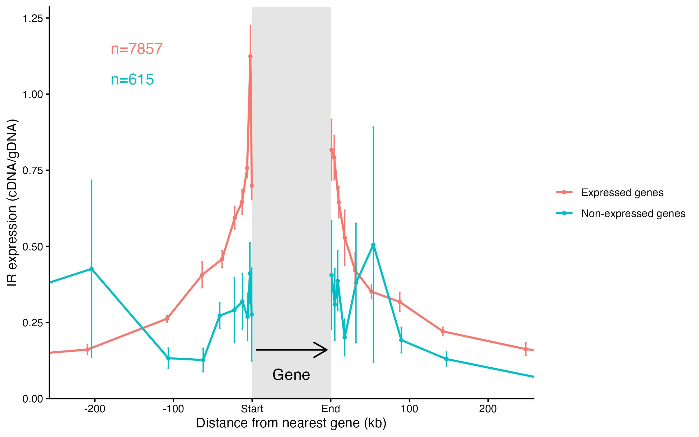
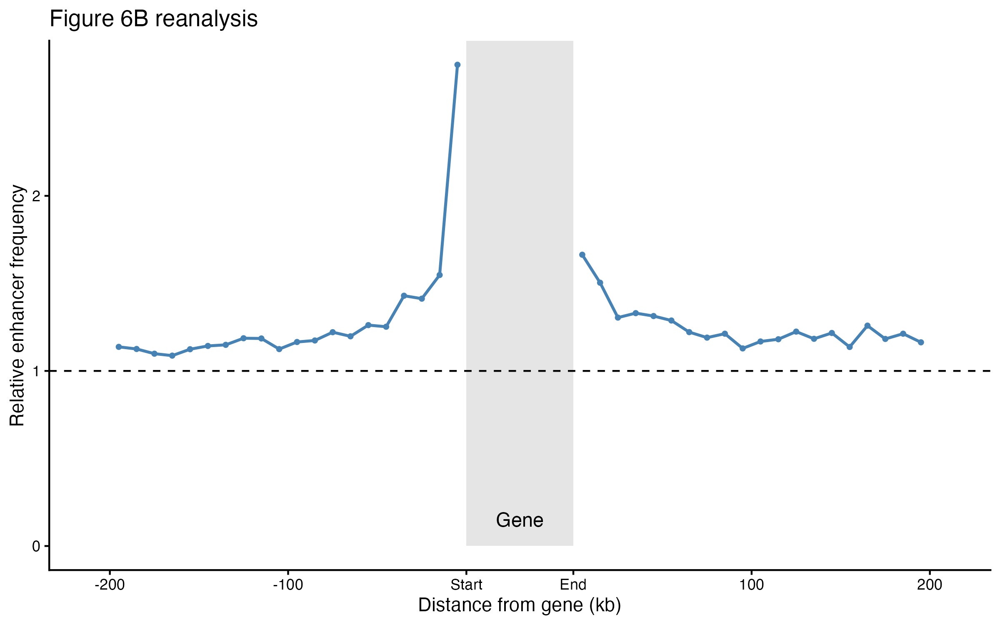

# Goal 1: Reproduce Figure 6 from Akhtar et al. (2013)

## Step 1: Convert TRIP integration coordinates from mm9 to mm10

- Convert the original TRIP integration file (`mmc2.txt`) into BED format.
- Use UCSC LiftOver to convert TRIP integration coordinates from mm9 to mm10.
- Use R to merge the original TRIP count columns with the lifted mm10 coordinates by matching `pool_barcode`.
- A total of 17,857 mPGK reporter integration sites (IRs) were included in the processed dataset.

Script: `scripts/txt-to-bed.sh`, `scripts/merge_mm10.Rmd`

## Step 2: Reanalyze Figure 6A

### 2.1 Classify genes as expressed or non-expressed

- We used RNA-seq counts from 11 monoclonal mESC lines (`mmc5.txt`).
- A gene was classified as expressed if at least one sample had a count > 0; otherwise, it was classified as non-expressed.
- A total of 18,463 genes were classified as expressed and 3,906 as non-expressed.
- Because the RNA-seq count table uses gene IDs from the older mm9-era annotation, we lifted that gene annotation from mm9 to mm10 while retaining the original Ensembl gene IDs.
- 37,494 gene records were successfully converted; 187 failed conversion.

Script: `scripts/6A_gtf-to-genebed.py`, `scripts/6A_make_gene_expression_status.py`

### 2.2 Identify intergenic TRIP IRs

- We identified intergenic IRs using the full gene annotation.
- A total of 8,472 intergenic IRs were identified.

Scripts: `6A_find_intergenic_IRs.sh`

### 2.3 Filter genes based on RNA-seq data

- We retained only genes with Ensembl IDs present in the RNA-seq count table.
- 22,241 of the 37,494 annotated genes were retained.

Scripts: `6A_filter_genes.py`

### 2.4 Find the nearest gene for each intergenic IR

- We recalculated the nearest gene using the filtered gene annotation.
- Therefore, the nearest gene refers to the nearest gene with available RNA-seq counts, which may not be the nearest gene in the full annotation.
- Nearest genes were assigned based on genomic distance using `bedtools closest`.
- Ties were retained, resulting in 8,475 IR-gene assignments for 8,472 intergenic IRs.

Scripts: `6A_find_nearest_gene.sh`

### 2.5 Assign gene expression status

- All 8,475 IR-gene assignments were successfully matched to RNA-seq expression status.
- No assignments were missing expression status.
- Among the 8,472 unique IRs, 7,857 were associated with expressed genes and 615 with non-expressed genes.

Scripts: `6A_add_gene_expression_status.py`

### 2.6 Assign gene side

- We classified IRs as being on the Start or End side of the nearest gene based on gene strand and genomic position.
- 4,778 IR-gene assignments were on the Start side, and 3,697 were on the End side.

Scripts: `6A_assign_gene_side.py`

### 2.7 Divide IRs into distance bins

- We divided IR-gene assignments into 10 equal-count distance bins separately for the Start and End sides.
- Expressed and non-expressed genes shared the same distance-bin boundaries on each side.
- All 8,475 IR-gene assignments were included in the analysis.

Scripts: `6A_make_distance_bins.py`

### 2.8 Calculate IR expression and reproduce Figure 6A

- We calculated reporter expression as the ratio of summed cDNA counts to summed gDNA counts across two technical replicates.
- For each TRIP pool, gene expression status, gene side, and distance bin, we calculated the median IR expression.
- We then calculated the mean and standard error of the mean (SEM) across the six mPGK pools.
- Of the 40 groups, 38 contained data from all six pools, while two contained data from five pools.
- We plotted IR expression as a function of distance from the nearest gene, separating the Start and End sides.

Scripts: `6A.Rmd`

### 2.9 Limitations

- The original endogenous gene expression dataset used for Figure 6A could not be identified.
- We therefore used the RNA-seq count matrix from the 11 monoclonal mESC lines, which was provided for the Figure 6E analysis.
- Gene expression status was determined using raw RNA-seq counts rather than the original FPKM-based classification.
- Nearest genes were selected only from genes with available RNA-seq counts. This may change nearest-gene assignments and distances compared with the original analysis.
- The reporter expression normalization used in this reanalysis is simplified and may differ from the original TRIP normalization method.
- Our reanalysis included 7,857 expressed-associated IRs and 615 non-expressed-associated IRs, compared with 5,435 and 2,746, respectively, in the published Figure 6A.
- Therefore, our current analysis reproduces the general relationship between gene proximity and reporter expression but does not fully reproduce the original Figure 6A.

### 2.10 Output files

- `data/processed/trip-distance-bins-filtered-mm10.tsv`: Processed IR-gene assignments with expression status, gene side, and distance bins.
- `results/figure6A_summary.tsv`: Mean IR expression, SEM, and distance information for each group.
- `results/figure6A_280kb.png`: Figure 6A reanalysis plot.

## Step 3: Reanalyze Figure 6B

**Goal:** Examine the distribution of active enhancer-like elements around endogenous genes and determine whether enhancers are enriched near gene boundaries.

Figure 6B in the original study shows the relative frequency of active intergenic enhancers around endogenous genes. To reproduce this analysis, we used ENCODE candidate cis-regulatory elements (cCREs) as an alternative source of enhancer annotations.

### 3.1 Filter enhancer-like elements

We used the ENCODE cCRE dataset for mouse embryonic stem cells (mm10, ENCSR433TOM; BED file: ENCFF110IIC).

We selected two enhancer-like categories:
- **dELS:** distal enhancer-like signatures
- **pELS:** proximal enhancer-like signatures

| Category | Number |
|---|---:|
| Total cCREs | 499,693 |
| Enhancer-like elements (dELS + pELS) | 17,235 |
| Other elements removed | 482,458 |

Script: `scripts/6B_filter_enhancers.py`

### 3.2 Identify intergenic enhancers

Since Figure 6B focuses on active intergenic enhancers, we excluded enhancer-like elements overlapping annotated gene bodies using `bedtools intersect -v`.

- Input: 17,235 enhancer-like elements
- Output: **7,871 intergenic enhancer-like elements**
- Gene annotation: mm9 gene annotations lifted over to mm10

Script: `scripts/6B_find_intergenic_enhancers.sh`

### 3.3 Generate gene-centered windows

We generated 10 kb non-overlapping windows extending 200 kb outward from both the Start and End boundaries of each gene, accounting for gene orientation.

- Each gene contributes up to 20 windows on each side (40 windows total).
- Windows extending entirely beyond chromosome position 0 were excluded.
- The original set of 37,494 annotated genes was used.

| Statistic | Number |
|---|---:|
| Genes processed | 37,494 |
| Expected windows (40 per gene) | 1,499,760 |
| Windows generated | 1,498,514 |
| Windows excluded | 1,246 |

The 1,246 missing windows were excluded because they fell outside the beginning of their chromosomes.

Script: `scripts/6B_make_gene_windows.py`

### 3.4 Count enhancers in each window

We used `bedtools intersect -c` to count the number of intergenic enhancer-like elements overlapping each 10 kb window.

| Statistic | Number |
|---|---:|
| Total windows | 1,498,514 |
| Windows without enhancers | 1,451,858 |
| Windows with at least one enhancer | 46,656 |
| Total enhancer-window overlaps | 88,951 |
| Maximum enhancers per window | 12 |

Approximately **3.1% of windows** contained at least one enhancer-like element.

Note that the total number of overlaps (88,951) is not the number of unique enhancers, since the same enhancer may overlap windows associated with multiple genes.

Script: `scripts/6B_count_enhancers.sh`

### 3.5 Calculate relative enhancer frequency

To estimate enhancer enrichment, we calculated the observed enhancer density for each distance bin and normalized it against the genome-wide intergenic enhancer density.

**Background calculation**

We downloaded mm10 chromosome sizes and used `bedtools merge` and `bedtools complement` to exclude annotated gene bodies and identify intergenic genomic regions.

| Statistic | Value |
|---|---:|
| Intergenic regions | 28,274 |
| Intergenic enhancer-like elements | 7,871 |
| Total intergenic genome length | 1,684,362,606 bp |
| Background enhancer density | 4.673 × 10⁻⁶ enhancers/bp |

**Relative frequency calculation**

For each distance bin:

- Observed enhancer density = Total enhancer-window overlaps / Total valid window length
- Background enhancer density = Total intergenic enhancers / Total intergenic genome length
- Relative enhancer frequency = Observed density / Background density

A relative frequency of 1 represents the genome-wide intergenic background expectation, while values above 1 indicate enrichment relative to this reference.

Scripts:
- `scripts/6B_prepare_background.sh`
- `scripts/6B_calculate_relative_frequency.py`

### 3.6 Plot Figure 6B

We plotted relative enhancer frequency against distance from gene boundaries, displaying Start and End regions on opposite sides of a schematic gene body.

- X-axis: Distance from gene Start or End (kb)
- Y-axis: Relative enhancer frequency
- Dashed horizontal line (y = 1): Genome-wide intergenic background expectation

Script: `scripts/6B_plot.R`

### Notes and limitations

This analysis is an approximate reanalysis rather than an exact reproduction of the original Figure 6B.

- The original study identified active enhancers using H3K4me1, H3K27ac, and p300 occupancy, whereas we used ENCODE dELS and pELS annotations.
- We used fixed 10 kb windows extending 200 kb from gene boundaries.
- We defined the background as genome-wide intergenic enhancer density. The exact normalization method used in the original study has not yet been confirmed.
- The observed enhancer density was calculated using total valid window length, which may include portions overlapping other gene bodies. Gene-centered windows can also overlap one another.

Therefore, the resulting relative frequencies should be interpreted as estimates of enhancer enrichment under our chosen annotation and background model, rather than directly comparable numerical values from the original publication.