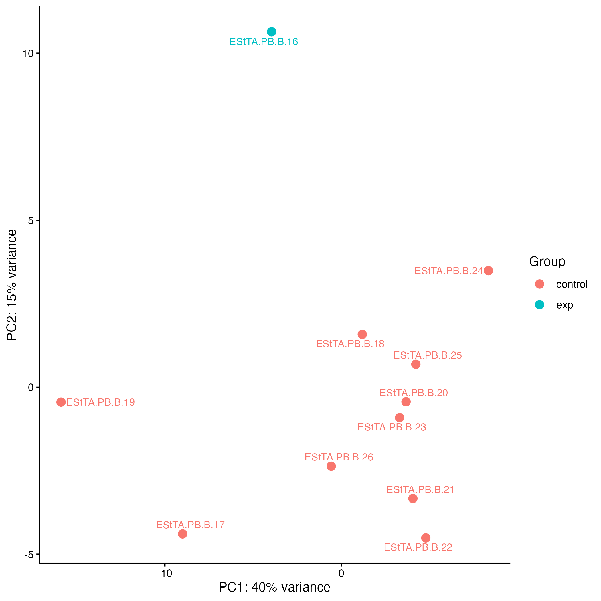
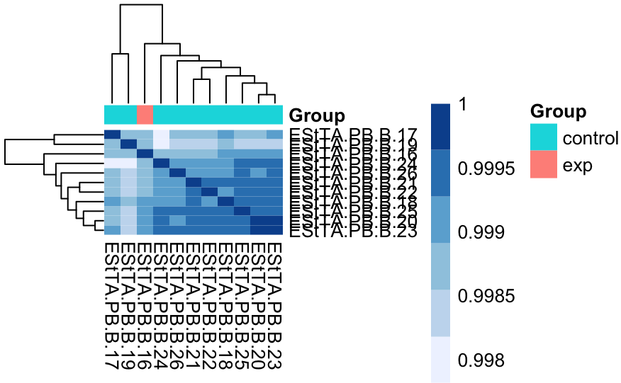
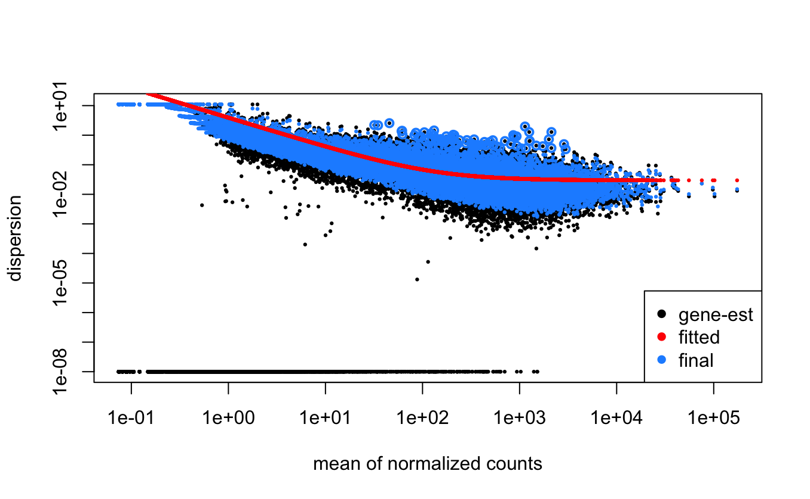

# Differential analysis of 11 TRIP Clones from the raw counts.

The summarized output (will be) in `rnaseq/results/results.rmd`

A TRIP clone are single cells selected from the transgene pool in order to test the impact of IRs on transcription. Each of the 11 clones has their own unique integrations in random locations throughout the genome. To run differnential analysis of the rna counts, the authors contrast each clone to the remaining 10. Here are the steps:

- 261009: Created metadata tables containing the clone name and their group (exp= the clone being tested, control= the remaining 10 clones). While this could have been automated, this was done manually by copying tables typed in excel into a text file using `vim.` Started building .Rmd of RNA seq analysis.

## Quality Control Plots for RNA seq analysis

##Multiple hypothesis testing 
- Used the holms method, which adjusts pval to accomodate multiple testing. this method strongly reduces the number of significant genes.
clone sig_padj sig_holm lost
C16   C16      373       36  337
C17   C17      434       48  386
C18   C18        2        1    1
C19   C19      710      135  575
C20   C20        5        4    1
C21   C21       90       33   57
C22   C22      156       23  133
C23   C23        3        2    1
C24   C24       70       13   57
C25   C25       35       20   15
C26   C26       35        5   30

